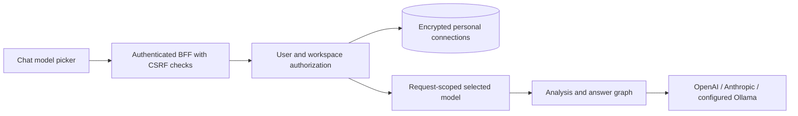

# Chat model selection

The composer has a compact model-and-effort pill. Its popover opens the effort slider; the model name opens the model list, with **Manage models & keys** at the bottom. That list includes configured server models and the signed-in user's personal connections in the current workspace. OpenAI is the default when `OPENAI_API_KEY` is configured. Selecting a model applies to query analysis, query rewriting, direct replies, answers, and conversation summaries. Selection does not fall back to another provider. Embeddings, receipt extraction, and optional evaluation keep their deployment routes.

Supported OpenAI reasoning models expose effort choices in `GET /v1/chat-models`; GPT-6 Luna supports Low, Medium, High, Extra high, and Max. Other supported reasoning families expose Low, Medium, and High. Unknown models and other providers do not expose this control, and the API rejects unsupported model/effort combinations before saving a question. `POST /v1/chat` accepts `reasoning_effort`; each conversation remembers it alongside the model. OpenAI structured and streaming requests both receive it. Completion limits include hidden reasoning, so explicit Low/Medium reserves at least 4,096 tokens and High/Extra high/Max at least 8,192, still bounded per request. Higher effort can increase latency and cost. See the [OpenAI GPT-6 Luna reference](https://developers.openai.com/api/docs/models/gpt-6-luna).

## API and storage

- `GET /v1/chat-models`: public metadata for configured models and the caller's connections; never keys or ciphertext.
- `POST /v1/model-connections`: provider, model ID, and a write-only API key for OpenAI/Anthropic. Ollama uses the deployment's `OLLAMA_BASE_URL`; arbitrary user-supplied URLs are not accepted.
- `DELETE /v1/model-connections/{id}`: removes only a caller-owned connection in the current workspace.
- `POST /v1/chat`: optional `model_id`; a conversation remembers its last selection. Unknown, removed, or another user's connection is rejected before saving a question or constructing model context.

Connections are scoped to both user and tenant. All three endpoints require a user session and chat permission; service API keys cannot access them. Each user can save at most 20 connections per workspace. Adding a connection stores the supplied model ID; provider credentials, model availability, and structured-output compatibility are checked when chatting.

Keys use AES-256-GCM with a random nonce and authenticated connection ID, user, tenant, provider, and model. In production, configure `MODEL_KEYS_ENCRYPTION_KEY` with at least 32 random characters. Keep it stable and backed up separately from the database; changing it requires users to re-add their keys. In development only, a domain-separated key derived from `JWT_SECRET` is used when this setting is absent, so rotating that JWT secret also makes saved provider keys unreadable. Keys are decrypted only for the model request, are excluded from graph state, messages, jobs and API responses, and are never stored in browser storage. Separate cloud clients are closed after each selected-model request, and concurrent chats cannot overwrite each other's selection.

Users choose an exact model ID that supports both structured JSON output and streaming chat. Ollama models must already be installed on the configured server. This avoids granting users arbitrary outbound network access or model installation privileges. A future model catalog could validate capabilities and discover installed Ollama models; a managed KMS would replace the deployment encryption secret as operational needs grow.
