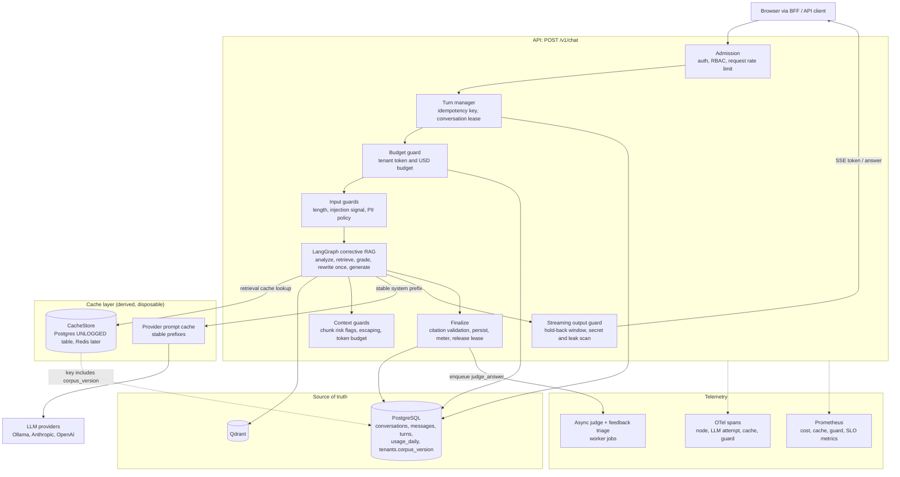
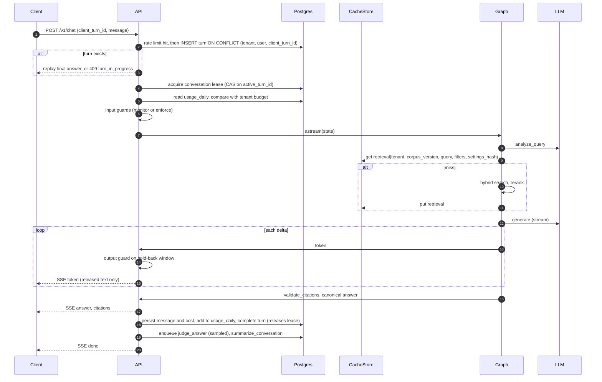

# HLD: LLM request path

Scope: the synchronous chat turn (`POST /v1/chat`) and the worker jobs it triggers. Ingestion, auth and the BFF are unchanged except where noted. Existing behaviour is described in [ARCHITECTURE.md §3–4](../ARCHITECTURE.md).

## Goals

| Goal | Measure |
| --- | --- |
| No unchecked model text reaches the client | 100% of `token` events pass the streaming guard; output-guard verdict recorded for every turn |
| Cost is bounded and attributable | Per-tenant daily token and USD budget enforced; `cost_usd` stored per message |
| Repeat work is not paid for twice | Retrieval-cache hit rate and prompt-cache read tokens visible on the dashboard; answer cache behind a flag |
| A turn is exactly-once from the user's view | Same `client_turn_id` returns the same turn; one active turn per conversation |
| Reliability is managed by error budget | SLOs for availability, TTFT and faithfulness with multi-window burn-rate alerts |

Non-goals: semantic (similarity-matched) answer caching, LLM-based moderation on the hot path, token-level stream resume, tool-using agents. Each is listed with its adoption trigger in the relevant LLD.

## Target architecture

## Turn sequence

## Components

| Component | New or existing | Responsibility | LLD |
| --- | --- | --- | --- |
| Turn manager | New (`src/rag/chat/turns.py`) | Idempotency, conversation lease, turn status transitions | [LLD-01](LLD-01-state.md) |
| History builder | Change (`src/rag/graph/graph.py:92`) | Token-budgeted window instead of fixed turns × chars | [LLD-01](LLD-01-state.md) |
| `CacheStore` | New (`src/rag/cache/`) | Get/put with TTL behind an interface; Postgres implementation | [LLD-02](LLD-02-caching.md) |
| Corpus version | New column `tenants.corpus_version` | Bumped wherever a document becomes ready, is deleted, or the index alias swaps | [LLD-02](LLD-02-caching.md) |
| Guard pipeline | New (`src/rag/guardrails/`) | Ordered guards per stage with `monitor`/`enforce` mode and verdict telemetry | [LLD-03](LLD-03-guardrails.md) |
| Streaming output guard | New, wraps `_stream_answer` (`src/rag/graph/graph.py:170`) | Releases text only after it passes a hold-back window scan | [LLD-03](LLD-03-guardrails.md) |
| Budget guard and meter | New (`usage_daily` table, price table in `config/models.yaml`) | Pre-turn budget check, post-turn increment, `cost_usd` per message | [LLD-03](LLD-03-guardrails.md), [LLD-04](LLD-04-observability.md) |
| SLO rules | New (`ops/prometheus/slo.yml`) | Recording rules and burn-rate alerts | [LLD-04](LLD-04-observability.md) |
| Feedback triage | New worker job | Thumbs-down and low-judge answers become eval-set candidates | [LLD-04](LLD-04-observability.md) |

## Latency budget (p95, cloud generation, warm local models)

| Stage | Today (est.) | Target | Notes |
| --- | --- | --- | --- |
| Admission + turn + budget | 2 DB round trips | ≤ 4 DB round trips, < 25 ms | Turn insert and lease share one transaction |
| Input guards | — | < 5 ms | Regex and length checks only; no model call on the hot path |
| analyze_query | 0.3–1.5 s | unchanged | Not cached: depends on history |
| Retrieval | 0.2–0.8 s | < 10 ms on hit | Rerank on CPU dominates a miss |
| Time to first released token | p95 alert at 3 s | ≤ 3 s | Hold-back window adds < 100 ms at typical token rates |

## Failure policy

| Dependency fails | Behaviour |
| --- | --- |
| CacheStore | Treated as a miss; `rag_cache_requests_total{outcome="error"}`; never fails the turn |
| Guard raises | Monitor mode: verdict `error`, turn continues. Enforce mode: fail closed for output guards, fail open for input heuristics (documented per guard) |
| Budget read | Fail open with a metric; the post-turn increment still runs, so overspend is bounded to in-flight turns |
| Lease holder crashes | Lease expires after `turn_lease_s`; the next request takes over and marks the old turn `abandoned` |
