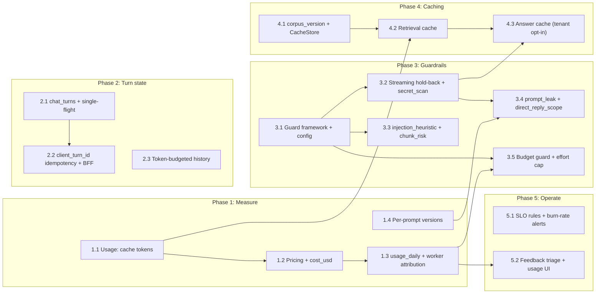

# Implementation plan

Five phases, 17 PRs. Each PR ships independently, behind a flag where behaviour changes, with its own migration and tests. Order follows the principle "measure, then protect, then optimise": cost and cache telemetry land before any cache, and every guard runs in monitor mode before it can block.

## Dependency graph

Phases 2 and 3 can run in parallel once Phase 1 has merged. Phase 4 needs 1.1 (to measure prompt-cache value) and 3.2 (answer cache stores only guard-approved text).

## Phase 1: Measure (week 1)

| PR | Change | Files | Acceptance |
| --- | --- | --- | --- |
| 1.1 | `Usage.cache_read_tokens` / `cache_write_tokens` mapped from Anthropic and OpenAI; `messages` columns; `llm_cached_tokens_total`; move the `respond_direct` summary out of the system message | `adapters/llm/{base,anthropic,openai}.py`, `graph/graph.py`, migration `0011` | Anthropic integration test shows `cache_read_tokens > 0` on the second identical call; prefix-stability unit test passes for every prompt |
| 1.2 | `pricing` block in `config/models.yaml`; `cost_usd` on `ModelUsage` and `messages`; `llm_cost_usd_total` | `adapters/llm/router.py`, `graph/graph.py`, `api/routers/chat.py`, migration `0012` | Unknown model costs 0 and logs once; cost of a recorded turn matches a hand calculation in a unit test |
| 1.3 | `usage_daily` upsert in the answer transaction; worker jobs attribute cost to the payload tenant | `api/routers/chat.py`, `worker/loop.py`, `receipts/extract.py`, `evaluation/judge.py`, `graph/summary.py`, migration `0013` | Sum of `messages.cost_usd` for a tenant-day equals `usage_daily.cost_usd` minus worker cost, in an integration test |
| 1.4 | Per-prompt versions via `config/prompts.yaml`; `debug.prompts` | `graph/graph.py`, `config/prompts.yaml` | Changing one prompt's version leaves the others unchanged in `debug.prompts` |

Rollback: columns are nullable and additive; reverting code leaves them null.

## Phase 2: Turn state (week 2)

| PR | Change | Files | Acceptance |
| --- | --- | --- | --- |
| 2.1 | `chat_turns` table, partial unique index, lease reaping, status transitions; `409 conversation_busy` | new `chat/turns.py`, `api/routers/chat.py`, migration `0014` | Concurrent turns on one conversation: exactly one proceeds; late writer after lease expiry persists nothing |
| 2.2 | `ChatIn.client_turn_id`; replay of completed turns; `GET .../turns/{id}`; BFF generates and reuses the id on retry; UI message for busy | `api/schemas.py`, `api/routers/chat.py`, `web/src/lib/sse.ts`, chat components, e2e spec | Playwright: double-submit produces one user message; reload mid-stream shows "still writing", then the answer |
| 2.3 | `history_max_tokens`; newest-first token packing; summary trigger based on window | `graph/graph.py`, `graph/summary.py`, `core/config.py` | Unit tests from [LLD-01](LLD-01-state.md#tests); eval run shows no drop in `graph_recall@k` on follow-up cases |

Flag: none needed for 2.1 (correctness fix). 2.3 keeps `history_turns` as the row cap, so setting `HISTORY_MAX_TOKENS=0` restores today's behaviour.

## Phase 3: Guardrails (weeks 3–4)

| PR | Change | Files | Acceptance |
| --- | --- | --- | --- |
| 3.1 | `Guard`, `Verdict`, pipeline, `config/guardrails.yaml`, verdict metrics, `debug.guards`; port the question length cap as the first guard | new `guardrails/` package | Monitor-mode guard never alters output (property test); metrics and debug populated |
| 3.2 | Hold-back buffer in `_stream_answer`; `secret_scan` (monitor) | `graph/graph.py`, `guardrails/stream.py` | Secret split across N deltas is never released when enforced; p95 TTFT regression < 100 ms in load test |
| 3.3 | Pattern library; `injection_heuristic` (monitor); `chunks.risk_flags` at ingestion + backfill job; `chunk_risk` | `guardrails/patterns.py`, `ingestion/pipeline.py`, migration `0015` | Pattern corpus tests; backfill job is resumable and batched |
| 3.4 | Prompt canaries + n-gram leak index; `prompt_leak`; `direct_reply_scope`; `evals/redteam.jsonl` in CI | `graph/prompts/*.txt`, `guardrails/`, `evals/`, `.github/workflows/ci.yml` | Red-team set passes: no canary or seeded secret in any final answer |
| 3.5 | `tenant_limits`, budget pre-check, `429 budget_exceeded`; effort cap by role | `api/routers/chat.py`, `adapters/llm/connections.py`, migration `0016` | Over-budget tenant blocked until UTC midnight; viewer request for `max` is capped to `medium` |

Promotion to enforce: a guard moves from `monitor` to `enforce` in a separate one-line config PR that links one week of verdict data and a sample review of flagged turns (by trace id, not content). That PR is the review artifact, not the code PR.

## Phase 4: Caching (week 5)

| PR | Change | Files | Acceptance |
| --- | --- | --- | --- |
| 4.1 | `tenants.corpus_version` bumped at ready, delete and alias swap; `CacheStore` protocol + Postgres `UNLOGGED` implementation; purge in worker | `cache/`, `ingestion/{pipeline,reindex}.py`, `api/routers/documents.py`, `worker/loop.py`, migration `0017` | Test enumerates every code path that changes document status and asserts a bump |
| 4.2 | Retrieval cache behind `CACHE_RETRIEVAL_ENABLED`; re-validation on hit; cache metrics and span attributes | `graph/graph.py` (`retrieve_node`), `retrieval/retriever.py` | Integration tests from [LLD-02](LLD-02-caching.md#tests); golden set twice: identical recall, lower p95 |
| 4.3 | Answer cache, tenant opt-in setting, replay without `token` events | `graph/graph.py`, `api/routers/chat.py`, tenant settings | Deleted cited document makes the cached answer a miss; cached turn records zero cost and `debug.cache` |

Rollback: flags off. The cache table can be truncated at any time without data loss.

## Phase 5: Operate (week 6)

| PR | Change | Files | Acceptance |
| --- | --- | --- | --- |
| 5.1 | `rag_online_judged_total{passed}`; `ops/prometheus/slo.yml`; burn-rate alerts with runbook sections and rule tests; Grafana SLO, cost, cache and guard rows | `core/metrics.py`, `evaluation/judge.py`, `ops/`, `docs/RUNBOOKS.md` | `promtool test rules` passes for each burn-rate alert |
| 5.2 | `triage_answer` job and `eval_candidates`; `GET /v1/usage`; Usage page chart | `worker/`, `api/routers/`, `web/src/components/usage-view.tsx` | Thumbs-down creates a candidate with a category; admin sees per-day cost |

## Definition of done (every PR)

- Unit and integration tests; RBAC matrix updated for new routes (`tests/unit/test_route_coverage.py` enforces it).
- New metrics documented in [ARCHITECTURE.md §5.3](../ARCHITECTURE.md); new span attributes covered by `test_trace_privacy.py`.
- New settings in `.env.example` with defaults that preserve current behaviour.
- Any change to prompts, retrieval or routing includes an eval run (baseline vs change) in the PR description.
- Alerts have a runbook entry and a rule test.

## Staffing and mentoring

| Work | Suggested owner | Why |
| --- | --- | --- |
| 1.1, 1.2, 1.4 | Mid-level engineer, paired review with the LLM path owner | Well-bounded; teaches the adapter layer and the eval workflow |
| 2.1, 2.2 | Senior engineer | Concurrency and idempotency across API, DB and BFF |
| 3.1, 3.2 | Senior engineer, design review before code | Sets the pattern every later guard follows; streaming changes affect TTFT |
| 3.3, 3.4 | Mid-level engineer after 3.1 merges | Pattern work with a clear test corpus; good introduction to threat modelling |
| 4.1–4.3 | Senior engineer | Invalidation correctness is the whole risk |
| 5.1 | Whoever is on call that week, reviewed by SRE owner | Builds ownership of the alerts they will receive |

Every PR author presents the change in the weekly architecture review for five minutes: what changed, what the metrics showed, what they would do differently. That is the mechanism for spreading context, not documentation alone.
