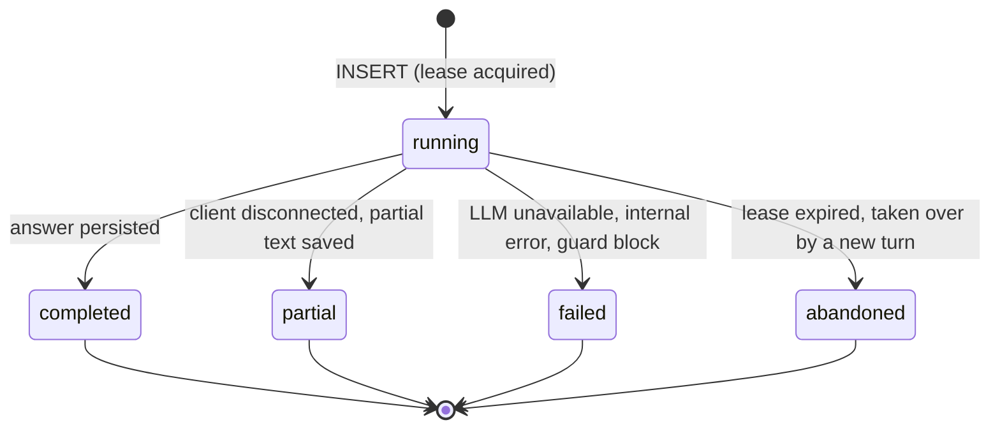
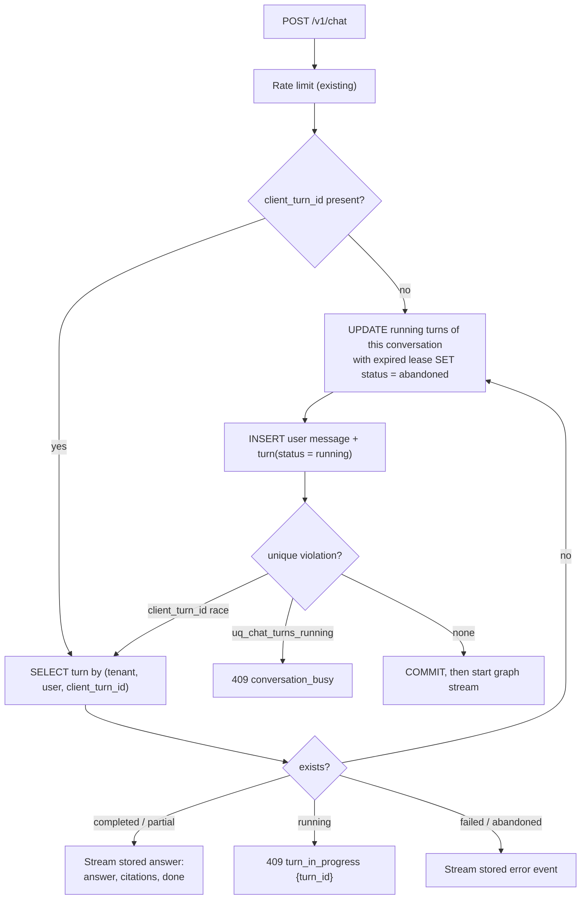

# LLD-01: Conversation and turn state

## Where state lives today

| State | Location | Lifetime | Notes |
| --- | --- | --- | --- |
| Graph working state | `RAGState` in memory (`src/rag/graph/graph.py:40`) | One turn | No checkpointer, by decision ([ARCHITECTURE.md §9](../ARCHITECTURE.md)) |
| Conversation history | `messages` table, last `HISTORY_TURNS` rows (`src/rag/api/routers/chat.py:101`) | Durable | Each turn truncated to 1500 chars in prompts (`src/rag/graph/graph.py:92`) |
| Rolling summary | `conversations.summary`, `summarized_count` | Durable | Updated by a worker job after each answer |
| Model selection | `conversations.model_id`, `reasoning_effort` | Durable | Per conversation |
| In-flight stream | API process memory | Until the SSE stream ends | Partial text saved on disconnect, flagged `debug.partial` |

## Problems

1. **Duplicate turns.** `POST /v1/chat` is not idempotent. A BFF retry, double click or network replay inserts a second user message and runs the graph twice, paying twice.
2. **Interleaved turns.** Two tabs on the same conversation can run concurrently. Each loads history before the other has saved, so both answers ignore each other, and the summary job can count messages from a half-finished turn.
3. **Unknown turn outcome.** After a disconnect the client cannot ask whether the turn is still running, finished or lost. It only sees whatever was saved.
4. **History cost is unbounded by tokens.** 6 turns × 1500 chars plus a 2000-char summary is roughly 3.5k tokens of history on every `analyze_query` call, regardless of the model's window or the user's message size.

## Design

### Data model

New table `chat_turns` (Alembic `0011_chat_turns`):

| Column | Type | Notes |
| --- | --- | --- |
| `id` | uuid PK | |
| `tenant_id` | uuid FK tenants | |
| `user_id` | uuid FK users | |
| `conversation_id` | uuid FK conversations, `ON DELETE CASCADE` | |
| `client_turn_id` | uuid null | Supplied by the client; null for legacy clients |
| `status` | varchar(16) | `running`, `completed`, `partial`, `failed`, `abandoned` |
| `question_message_id` | uuid FK messages | |
| `answer_message_id` | uuid FK messages null | |
| `lease_expires_at` | timestamptz | `now() + turn_lease_s` at start |
| `error_code` | varchar(32) null | `llm_unavailable`, `internal_error`, `guard_blocked`, `budget_exceeded` |
| `started_at`, `finished_at` | timestamptz | |

Constraints:

- `UNIQUE (tenant_id, user_id, client_turn_id)`: idempotency. Scoped to the user, not the conversation, so a retried first message does not create a second conversation.
- `CREATE UNIQUE INDEX uq_chat_turns_running ON chat_turns (conversation_id) WHERE status = 'running'`: at most one running turn per conversation, enforced by Postgres rather than application locks.

`turn_lease_s` defaults to 330 s: the stream ceiling (`_STREAM_CEILING_S = 300`, `src/rag/adapters/llm/router.py:42`) plus margin. Because the stream is already bounded, the lease needs no heartbeat.

### Turn lifecycle

All transitions out of `running` are a single `UPDATE ... WHERE id = :id AND status = 'running'`. If it updates zero rows, the turn was already abandoned and the late writer discards its result instead of persisting an answer into a conversation that has moved on.

### Admission flow

The reap, insert and user-message insert run in the transaction that already commits the user message at `src/rag/api/routers/chat.py:112`. No extra commit is added.

### API changes

- `ChatIn.client_turn_id: uuid.UUID | None`. The BFF generates one per user submission and reuses it on retry.
- New errors: `409 turn_in_progress` (same key, still running) and `409 conversation_busy` (different key, another turn running). The web client shows "Another reply is still being written in this chat".
- `GET /v1/conversations/{id}/turns/{turn_id}` returns `{status, answer_message_id, error_code}`. The client polls it after a dropped stream instead of guessing from the message list.
- The `done` SSE event gains `turn_id`.

Legacy clients that omit `client_turn_id` still get single-flight protection; they lose only replay.

### Token-budgeted history

Replace the fixed `HISTORY_TURNS` window with a token budget:

- New setting `history_max_tokens` (default 2000, bounds 0–16000). `history_turns` remains as an upper bound on rows fetched (raise default to 20).
- Build newest-first: include whole turns while the running `cl100k_base` count (the tokenizer already used by `src/rag/retrieval/context.py`) stays within budget; the summary is counted first.
- A single turn larger than the remaining budget is truncated from the middle, keeping its first and last 25%, rather than dropped. The latest assistant answer often carries the referent of the follow-up question.
- `maybe_enqueue_summary` switches from message count to "oldest message not in the window". The summary job then covers exactly what the window drops.

### Graph state contract

Rules for anyone adding to `RAGState`:

1. Keys are additive across releases. A renamed key breaks in-flight evals and `messages.debug` readers.
2. No raw document text beyond `chunks`. Large intermediate values are referenced by id.
3. Anything the UI or evals need after the turn goes into `messages.debug` explicitly in `_run` (`src/rag/api/routers/chat.py:204`), never by persisting `RAGState` wholesale.
4. Reducers (`Annotated[..., operator.add]`) are only for append-only lists such as `path` and `models_used`.

## Adoption triggers for deferred work

| Deferred | Adopt when |
| --- | --- |
| LangGraph Postgres checkpointer | A node needs human approval (interrupt) or a turn exceeds the stream ceiling |
| Token-level stream resume (event log + `Last-Event-ID`) | `partial` turns exceed 2% of turns on mobile clients |
| Server-side conversation memory beyond the summary (facts store) | Eval set shows follow-up failures attributable to summary loss |

## Tests

- Integration: same `client_turn_id` twice returns one user message and replays the answer; concurrent requests to one conversation yield one `200` and one `409 conversation_busy`; an expired lease is reaped and the late writer persists nothing.
- Unit: history builder respects the budget, counts the summary first, and truncates an oversized latest turn instead of dropping it.
- Migration: existing conversations have no turns; the first new turn works without backfill.
