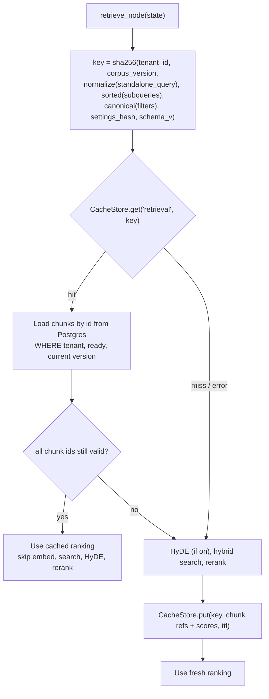

# LLD-02: Caching

## What a cache can and cannot save in this system

A chat turn costs, in order: `analyze_query` (one LLM call, depends on history), retrieval (query embedding, hybrid search, CPU cross-encoder rerank), optionally HyDE (one LLM call), then generation (one streamed LLM call, the largest cost). Each layer below targets one of those costs, and each has a different correctness risk.

| Layer | Saves | Key depends on | Correctness risk | Decision |
| --- | --- | --- | --- | --- |
| L0 provider prompt cache | Input-token cost and prefill latency on repeated prefixes | Byte-identical prefix | None if the prefix is static | **Keep, measure, and extend** |
| L1 query-embedding cache | Embedding call (10–50 ms locally) | Embedding model, dimension, query text | None | **Process-local LRU only**: too cheap to justify a shared store |
| L2 retrieval cache | Search + rerank (0.2–0.8 s CPU) and HyDE call | Tenant, corpus version, query, subqueries, filters, retrieval settings | Stale chunks after a document change | **Build**, invalidated by corpus version |
| L3 exact answer cache | Generation (the dominant cost) | L2 key + model, effort, prompt version | Stale or context-inappropriate answer | **Build behind a flag, off by default** |
| L4 semantic answer cache | Generation for paraphrases | Embedding similarity | False positives give confident wrong answers, across users of a tenant | **Rejected for now** ([ADR-0003](../adr/0003-corpus-version-cache-invalidation.md)) |

`analyze_query` is not cached: its input includes conversation history, so hit rates would be near zero.

## L0: provider prompt caching

Current state: the Anthropic adapter marks the system prompt `cache_control: ephemeral` (`src/rag/adapters/llm/anthropic.py:55`). OpenAI caches prefixes of 1024+ tokens automatically. Neither result is measured because `Usage` (`src/rag/adapters/llm/base.py:41`) has only `tokens_in` and `tokens_out`.

Changes:

1. Extend `Usage` with `cache_read_tokens` and `cache_write_tokens`. Map Anthropic `usage.cache_read_input_tokens` / `cache_creation_input_tokens` and OpenAI `usage.prompt_tokens_details.cached_tokens`. Ollama reports neither; leave both zero.
2. Persist both on `messages` (columns `cache_read_tokens`, `cache_write_tokens`) and export `llm_cached_tokens_total{purpose,provider,model,kind}`.
3. Prefix discipline, enforced by a unit test that renders each prompt twice with different inputs and asserts the shared prefix length:
   - The system prompt is static per prompt version. No dates, tenant names or model names in it.
   - Volatile content (summary, history, documents, question) lives only in messages after the system prompt. `respond_direct` currently passes the summary as a second **system** message (`src/rag/graph/graph.py:188`); because `split_system` concatenates all system messages, that change makes the cached prefix differ per conversation. Move the summary into the first user message.
4. Anthropic's minimum cacheable prefix is model-dependent. If the measured cache-read ratio stays at zero for a route, the prompt is below the minimum and the `cache_control` marker is harmless overhead; record that finding rather than padding prompts.

## Corpus version: the invalidation primitive

Add `tenants.corpus_version bigint NOT NULL DEFAULT 0`. Increment it in the **same transaction** as any change to what retrieval can return for that tenant:

| Event | Code location |
| --- | --- |
| Document version becomes `ready` | `src/rag/ingestion/pipeline.py:162` |
| Document marked deleted | `src/rag/api/routers/documents.py` delete handler |
| Reindex alias swap completes | `src/rag/ingestion/reindex.py` |
| Retrieval-affecting settings change | Not a DB event: covered by `settings_hash` in the key |

Every L2/L3 key includes `corpus_version`. Invalidation is therefore free: after a bump, old keys are never read again and expire by TTL. No scan, no pub/sub, no race between "delete cache" and "commit change".

The API reads `corpus_version` once per turn, in the query that already loads the conversation, and passes it in `RAGState`.

## Cache store

```python
class CacheStore(Protocol):
    async def get(self, namespace: str, key: str) -> bytes | None: ...
    async def put(self, namespace: str, key: str, value: bytes, ttl_s: int) -> None: ...
```

MVP implementation: Postgres `UNLOGGED` table, so writes skip the WAL and the table is truncated after a crash, which is correct for a derived cache.

```sql
CREATE UNLOGGED TABLE llm_cache (
  namespace  varchar(32)  NOT NULL,
  key        char(64)     NOT NULL,   -- sha256 hex
  tenant_id  uuid         NOT NULL,
  value      bytea        NOT NULL,
  expires_at timestamptz  NOT NULL,
  PRIMARY KEY (namespace, key)
);
CREATE INDEX ix_llm_cache_expires ON llm_cache (expires_at);
```

- `get` filters `expires_at > now()`. The worker's periodic purge (`src/rag/worker/loop.py:153`) also deletes expired cache rows in bounded batches.
- `tenant_id` is stored for tenant deletion and per-tenant size reporting. It is also inside the hashed key, so a lookup can never cross tenants even if the column were wrong.
- Values are JSON encoded as bytes, with a `schema` field so a release that changes the shape treats old values as misses.
- Store errors are caught at the call site, counted as `outcome="error"`, and treated as a miss.

Migration path to Redis is in [ADR-0002](../adr/0002-cache-store-postgres-first.md): same interface, triggered by measured lookup latency or write volume.

## L2: retrieval cache



- **Value**: ordered `(doc_id, doc_version, chunk_index, score)` tuples plus `reranked`. Never chunk text: text is re-read from Postgres on a hit, through the same tenant/ready/version check retrieval already performs (`src/rag/retrieval/retriever.py`). The cache cannot serve text the user may no longer see.
- **`normalize`**: Unicode NFKC, casefold, collapse whitespace, strip trailing punctuation. No stemming or synonym handling; that is the semantic cache's risk in disguise.
- **`settings_hash`**: sha256 over `retrieval_top_k`, `retrieval_prefetch`, `retrieval_neighbor_radius`, `retrieval_hyde`, `retrieval_max_subqueries`, `context_max_tokens`, `reranker_model`, `embedding_model`, `embedding_dim`. A config change is a cache miss, not a stale hit.
- **TTL**: 24 h (`cache_retrieval_ttl_s`). Corpus changes already invalidate; the TTL bounds storage.
- **Corrective rewrite**: the rewritten query is a different key, so a retry never reuses the failed ranking.
- **Flag**: `CACHE_RETRIEVAL_ENABLED` (default `false` until the dashboard shows the hit rate on staging).

## L3: exact answer cache

Eligible only when **all** hold:

- `needs_retrieval` is true and the turn reached `validate_citations` with at least one valid citation.
- No `doc_id` filter from the request body (document-scoped chats are typically one-off).
- Output-guard verdict is `allow` ([LLD-03](LLD-03-guardrails.md)).
- `answer_cache_enabled` is on for the tenant (tenant setting, default off).

Key: the L2 key plus `model_id`, `reasoning_effort`, and the generate prompt's version. Value: canonical answer text, citation refs, the original `message_id` and `models_used`.

On a hit:

1. Re-validate citation refs against current document versions (same check as L2). Any invalid ref is a miss.
2. Stream the stored answer as `answer` + `citations` events; no `token` events. The UI path is unchanged because it already treats `answer` as canonical.
3. Persist a new assistant message with `debug.cache = {"layer": "answer", "source_message_id": ...}`, zero tokens, zero cost.
4. Do not enqueue `judge_answer` for cached answers; the source answer was eligible already.

Why off by default: two users in a tenant asking the same standalone question get the same answer even if the second user's conversation context would have produced a different nuance. The `standalone_query` absorbs most context, but the tenant owner should opt in knowingly.

## Telemetry

| Signal | Labels |
| --- | --- |
| `rag_cache_requests_total` | `layer` (`retrieval`, `answer`), `outcome` (`hit`, `miss`, `stale`, `error`) |
| `rag_cache_lookup_seconds` | `layer` |
| `llm_cached_tokens_total` | `purpose`, `provider`, `model`, `kind` (`read`, `write`) |
| Span attribute `rag.cache.retrieval`, `rag.cache.answer` | `hit` / `miss` / `stale` / `error`; added to `_SAFE_ATTRIBUTES` (`src/rag/core/telemetry.py:20`) |

`stale` means the key hit but a chunk ref failed re-validation. A rising stale rate means `corpus_version` is not being bumped somewhere.

## Tests

- Unit: key changes when any component changes; `normalize` is idempotent; settings hash covers every retrieval setting (test enumerates `Settings` fields with the `retrieval_` prefix so a new setting fails the test until added).
- Integration: upload → ask → hit; delete the document → same question is a miss (corpus version bumped); tenant A's key never returns for tenant B; stale ref falls back to a fresh search; store outage (table dropped) still answers.
- Eval: run the golden set twice with the cache on; second run must have identical `graph_recall@k` and lower p95 latency.
