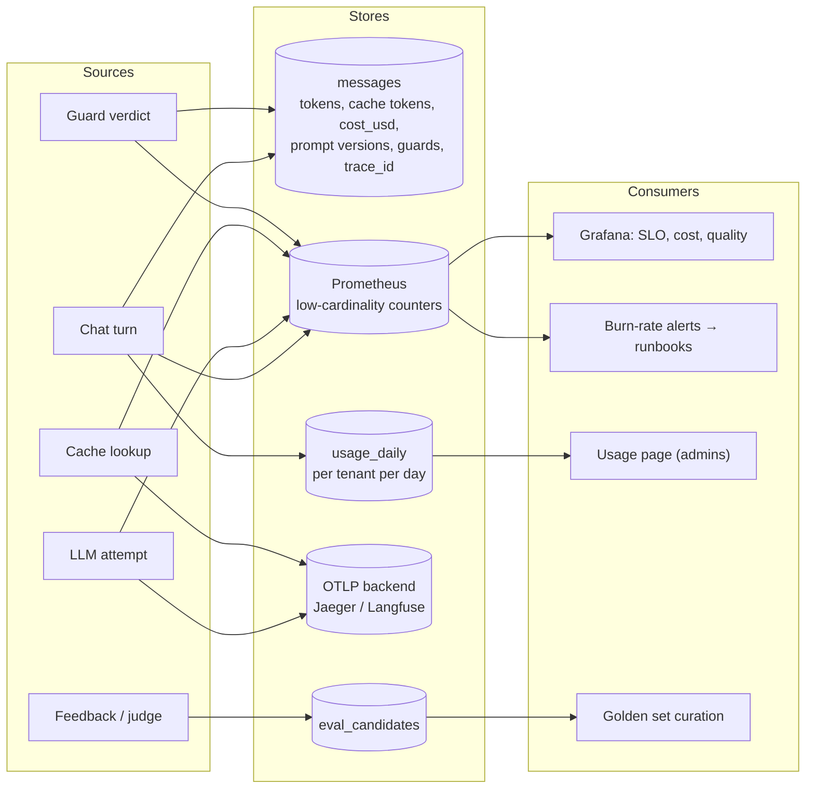
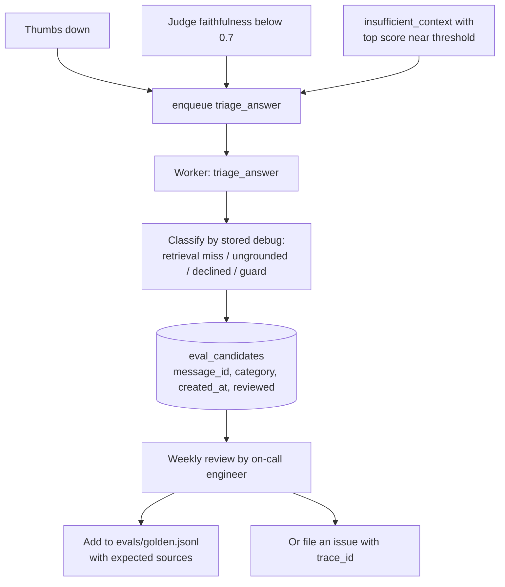

# LLD-04: Observability

The existing stack (OTel traces with a privacy-filtering exporter, Prometheus metrics, DB-derived gauges, alerts with runbooks, sampled online judge) is sound and stays. This LLD adds what turns telemetry into operating decisions: cost, SLOs, cache and guard visibility, and a loop from bad answers back to the eval set.

## Signal map



**Cardinality rule.** Tenant and user ids never become Prometheus labels. Per-tenant views come from Postgres (`usage_daily`, `messages`). Prometheus labels stay within `purpose`, `provider`, `model`, `outcome`, `layer`, `guard`, `stage`, `action`.

## Cost accounting

Prices are configuration, not code, next to the routes that use them:

```yaml
# config/models.yaml
pricing:                      # USD per million tokens; review on provider price changes
  anthropic/claude-sonnet-5-5: { input: 0.0, output: 0.0, cache_read: 0.0, cache_write: 0.0 }
  openai/gpt-5-mini:          { input: 0.0, output: 0.0, cache_read: 0.0 }
  ollama/*:                   { input: 0, output: 0 }
```

Values are placeholders: fill them from the providers' current price pages when implementing, and record the date in a comment. A model without a price entry logs `llm_price_missing` once per process and costs 0, so a new model never breaks chat.

- `ModelUsage` gains `cache_read_tokens`, `cache_write_tokens`, `cost_usd`. Cost is computed in `_usage` (`src/rag/graph/graph.py:79`) from the price table.
- `messages.cost_usd numeric(12,6)`; `usage_daily.cost_usd` incremented in the same transaction ([LLD-03](LLD-03-guardrails.md)).
- Metric `llm_cost_usd_total{purpose,provider,model}`.
- Worker routes (`receipt_extraction`, `eval_judge`, summary) also record cost into `usage_daily`, attributed to the tenant in their payload. Otherwise background work is invisible spend.
- `GET /v1/usage?from=&to=` (admin) returns per-day tokens, cost and turns for the tenant; the Usage page (`web/src/components/usage-view.tsx`) adds a chart beside the current document counts.

## SLOs

Defined over 28 days. Recording rules in `ops/prometheus/slo.yml`; existing static alerts stay until the burn-rate alerts have run for one cycle without false pages.

| SLO | SLI | Target |
| --- | --- | --- |
| Chat availability | `rag_answers_total{outcome!="error"}` / `rag_answers_total` | 99.5% |
| Responsiveness | Share of turns with TTFT ≤ 3 s (`rag_time_to_first_token_seconds_bucket{le="3"}`) | 95% |
| Answer quality | Share of judged answers with faithfulness ≥ 0.8 | 90% |
| Ingestion freshness | Share of documents ready within 5 min of upload | 95% |

The quality SLI needs a new counter, `rag_online_judged_total{passed}`, incremented by the `judge_answer` job. The existing 24 h average gauge hides the distribution.

Multi-window, multi-burn-rate alerts (page on fast burn, ticket on slow burn):

| Severity | Long window | Short window | Burn rate | Budget spent if sustained |
| --- | --- | --- | --- | --- |
| page | 1 h | 5 min | 14.4 | 2% in 1 h |
| page | 6 h | 30 min | 6 | 5% in 6 h |
| ticket | 3 d | 6 h | 1 | 10% in 3 d |

```yaml
# ops/prometheus/slo.yml (availability; the others follow the same shape)
groups:
  - name: slo-chat-availability
    rules:
      - record: slo:chat_errors:ratio_rate1h
        expr: sum(rate(rag_answers_total{outcome="error"}[1h])) / clamp_min(sum(rate(rag_answers_total[1h])), 1e-9)
      - record: slo:chat_errors:ratio_rate5m
        expr: sum(rate(rag_answers_total{outcome="error"}[5m])) / clamp_min(sum(rate(rag_answers_total[5m])), 1e-9)
      - alert: ChatAvailabilityFastBurn
        expr: slo:chat_errors:ratio_rate1h > (14.4 * 0.005) and slo:chat_errors:ratio_rate5m > (14.4 * 0.005)
        labels: { severity: page }
        annotations: { runbook: "docs/RUNBOOKS.md#chat-availability-burn" }
```

Each new alert gets a runbook section and a case in `ops/prometheus/alerts.test.yml`, matching the current convention.

## Cache and guard telemetry

Defined in [LLD-02](LLD-02-caching.md#telemetry) and [LLD-03](LLD-03-guardrails.md#guard-framework). Dashboard rows:

- **Cache**: hit rate by layer; stale rate (should be ~0); prompt-cache read ratio `llm_cached_tokens_total{kind="read"} / llm_tokens_total{direction="in"}` per route; estimated USD saved.
- **Guards**: verdicts per guard by mode; monitor-mode "would have blocked" rate, which is the number reviewed before promoting a guard to enforce; guard latency p99.
- **Cost**: USD per hour by route and model; cost per answered turn; top tenants by spend (table panel backed by the Postgres datasource, not Prometheus).

Alerts: `CacheStaleRateHigh` (> 1% for 30 min: a missing `corpus_version` bump), `GuardBlockRateSpike` (enforce-mode blocks > 3× the 7-day baseline: either an attack or a bad pattern), `TenantBudgetNearLimit` (DB-derived gauge of tenants above 80% of daily budget; ticket, not page).

## Prompt versioning

Today one `PROMPT_VERSION = "v1"` covers every prompt (`src/rag/graph/graph.py:29`), so changing one prompt either silently changes "v1" or bumps all of them.

- Each prompt file carries its own version: `generate.v2.txt` while `analyze_query.v1.txt` stays.
- `config/prompts.yaml` maps prompt name to active version. `prompt(name)` reads the mapping.
- `messages.debug.prompts = {"analyze_query": "v1", "generate": "v2"}`. The existing `prompt_version` column stores the `generate` version, which is what answer quality depends on most.
- A prompt change PR must include an eval run comparing old and new versions ([TECH_DIRECTION.md](../engineering/TECH_DIRECTION.md)).

## Feedback loop



- `eval_candidates` stores references (message id, category), never copies of document text. Review happens inside the tenant's access boundary; candidates from customer tenants become golden cases only with synthetic or consented content.
- The weekly review is the forcing function that keeps the golden set representative. It is a rotating responsibility, which is also how engineers learn the failure modes of the system.

## Trace attributes to add

Extend `_SAFE_ATTRIBUTES` (`src/rag/core/telemetry.py:20`), keeping the rule that no prompt, question or document text is exported:

`rag.turn_id`, `rag.cache.retrieval`, `rag.cache.answer`, `rag.guard.blocked` (guard name or empty), `rag.guard.flags` (count), `gen_ai.usage.cache_read_tokens`, `rag.cost_usd`, `rag.prompt.generate`.

`test_trace_privacy.py` gains a case for each new attribute asserting its value type is an id, enum, number or boolean.
